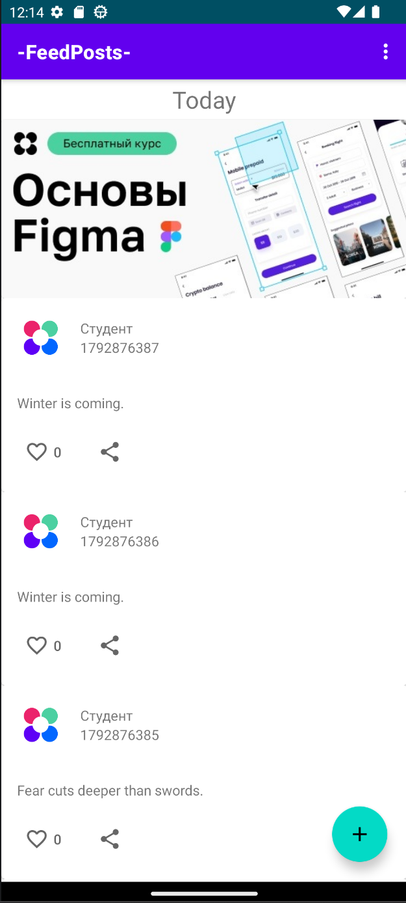
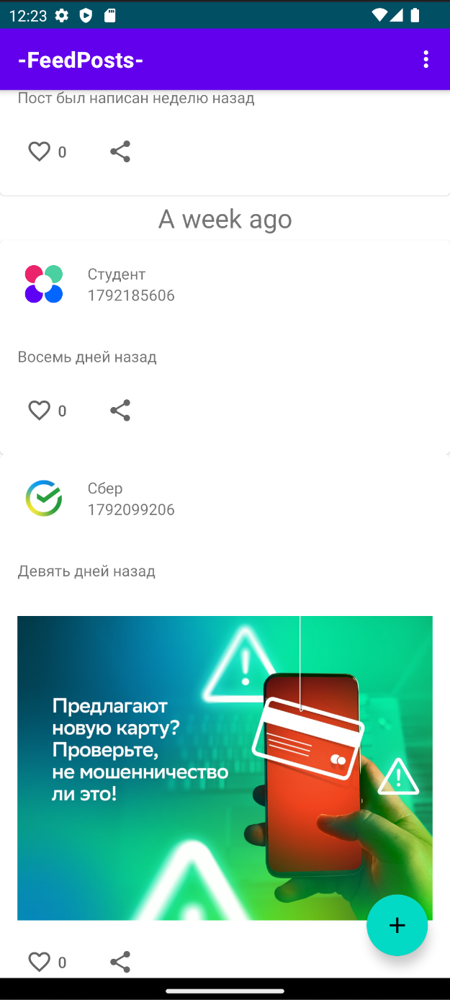
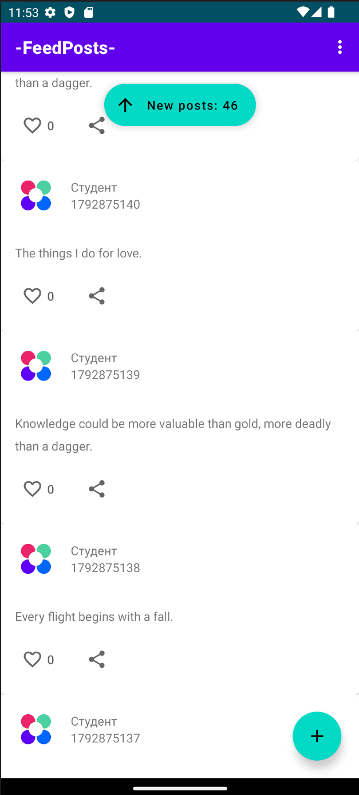
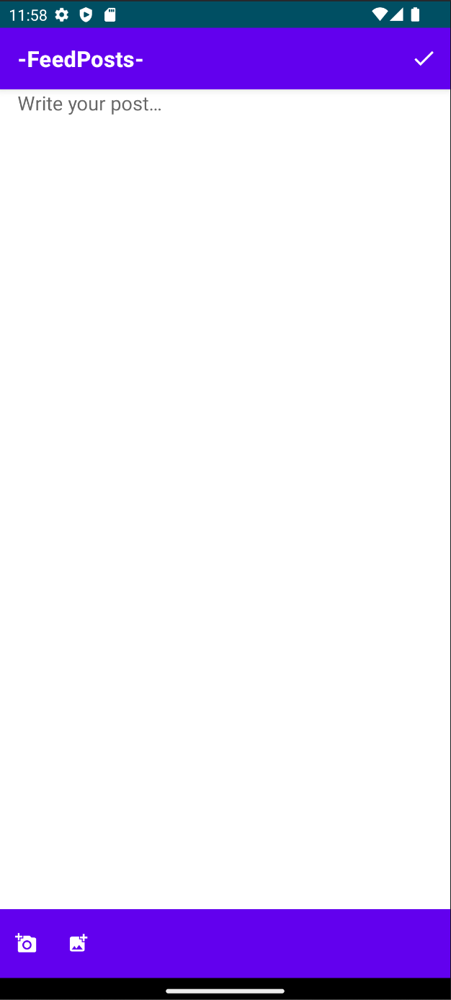
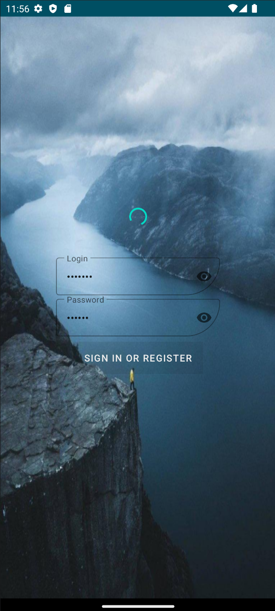

## -FeedPosts-

Учебный Android-проект в рамках курса «Android Developer». Простая социальная сеть: лента постов, авторизация, создание и редактирование записей, лайки и push-уведомления.

## 📋 Что умеет приложение

| Блок | Возможности |
|------|-------------|
| **Лента** | Swipe-to-refresh, разделители по датам («Сегодня», «Вчера», «Неделю назад»), рекламные вставки каждые 5 постов |
| **Посты** | Создание, редактирование, удаление своих записей, прикрепление изображений |
| **Лайки** | Поставить/убрать лайк с мгновенным откликом в UI |
| **Авторизация** | Вход по логину и паролю |
| **Пуши** | Firebase Cloud Messaging: приём уведомлений, отправка токена на сервер |

## 🧱 Из чего собрано

**Основной стек:** Kotlin, MVVM, Single Activity, Dagger Hilt, Coroutines + Flow, Retrofit + OkHttp, Room, Navigation Component, Glide, Firebase Cloud Messaging.

**Особенности реализации:**
- **Разделители по датам** – лента группируется по времени публикации.
- **Реклама через каждые 5 элементов** – имитация монетизации через вставку рекламных блоков в ленту.
- **Кеширование** – Room для локального хранения и офлайн-режима.
- **Кнопка `New posts`** – проматывает список в начало и добавляет новые посты в ленту.
- **Push-уведомления** – обработка входящих сообщений и отправка FCM-токена при авторизации.

## 🖼 Экраны

**Лента и посты**

  
  <!--  -->
  
  
  

**Авторизация**

  

## 📝 Контекст проекта

Проект выполнен в рамках курса «Android Developer» и представляет собой учебную реализацию социальной сети с базовым набором функций. Основная цель – практика работы с MVVM-архитектурой, сетевым слоем, DI и push-уведомлениями. Работа отражает освоение ключевых инструментов Android-разработки на практике.

---

*Android Developer · учебный проект*
